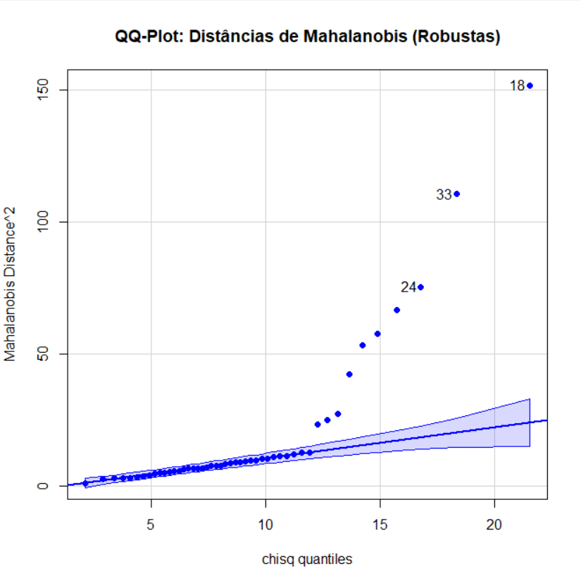
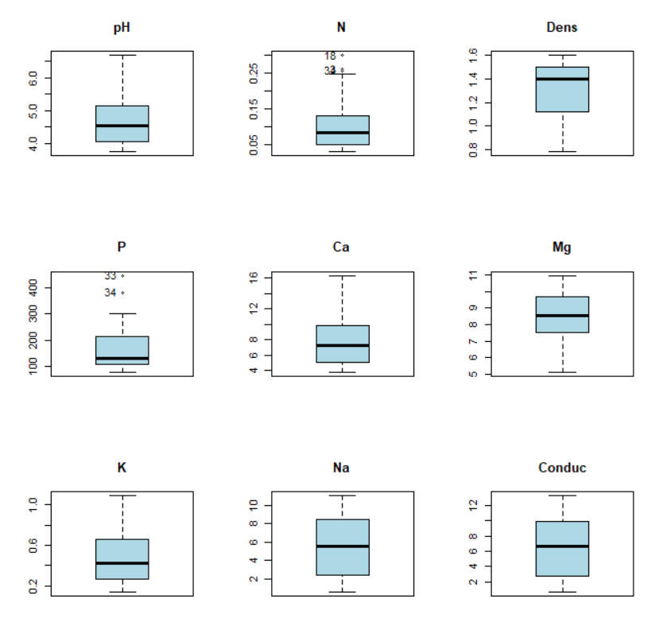

# 🌱 What makes soil acidic? A regression study in R

> **TL;DR:** Using a dataset of soil samples, we built a statistical model in **R** that explains a soil's **pH** (how acidic it is) from its chemical properties. Starting from 8 candidate variables, we kept only 3 (**calcium, sodium and conductivity**) that together explain about **71%** of the variation in pH. Along the way we cleaned the data with robust statistics and detected unusual samples. University project for *Statistical Methods for Artificial Intelligence* at Instituto Superior Técnico.

---

## What is this, in plain words?

**Linear regression** is one of the most used tools in data science: it finds a formula like

```
pH ≈ a + b·Calcium + c·Sodium + d·Conductivity
```

that predicts one value from others. The hard parts are choosing **which** variables to use (more is not always better) and checking that the model can be trusted.

The data is the `Soils` dataset (R package `carData`): 48 soil samples with 9 measurements each (pH, nitrogen, density, phosphorus, calcium, magnesium, potassium, sodium, conductivity).

## What we did

1. **Exploratory analysis:** compared classic and robust statistics (mean vs. winsorized mean, standard deviation vs. MAD), boxplots, QQ-plots, and found that some variables (e.g. phosphorus) are very skewed.
2. **Outlier detection:** used **Mahalanobis distances** to find samples that are unusual when all variables are considered together.
3. **Full model:** multiple linear regression of pH on all 8 other variables.
4. **Variable selection:** **backward elimination**, removing one non-significant variable at a time (N, P, Mg, K, Dens), following the *principle of parsimony* (the simplest model that explains the data well).
5. **Validation:** global F-test and significance of each remaining coefficient (5% level).
6. **Prediction:** computed **confidence intervals** (for the average pH) and **prediction intervals** (for a single new sample) for observations 12 and 24, and explained why prediction intervals are wider.

## Results at a glance

**Final model** (after backward elimination, 48 samples):

| Term | Estimate | Std. error | p-value |
|---|---|---|---|
| Intercept | 4.151 | 0.394 | < 0.001 |
| Calcium (Ca) | +0.106 | 0.031 | 0.001 |
| Sodium (Na) | +0.151 | 0.072 | 0.042 |
| Conductivity | −0.178 | 0.066 | 0.010 |

R² = **0.710** (adjusted 0.690) · F = 35.9 on 3 and 44 df, p < 0.001. The full model with all 8 variables had R² = 0.756, so dropping 5 variables cost less than 5 points of R².

In plain words: more calcium goes with a less acidic soil (higher pH). Sodium and conductivity are almost the same signal (correlation 0.97), which helps explain why their coefficients have opposite signs.

**Unusual samples.** Samples 18, 33 and 24 sit far above the expected line in the robust Mahalanobis QQ-plot, so they were flagged before modelling.



**Skewed variables.** Phosphorus (P) and nitrogen (N) are skewed to the right, with a few very high samples, which is why robust statistics were used alongside the classic ones.



## How to run it

```r
install.packages(c("carData", "rrcov", "psych", "car", "ggplot2", "WRS2"))
source("analysis.R")
```

## Files

| File | Content |
|---|---|
| `analysis.R` | All the R code, organised by question |
| `figures/` | Key plots shown in this README |
| `report.pdf` | Full report with plots, tables and discussion (in Portuguese) |

## Authors

Vasco Caetano and group colleagues, Instituto Superior Técnico.

## Context

- **Course:** Statistical Methods for Artificial Intelligence (Métodos Estatísticos para Inteligência Artificial), Instituto Superior Técnico, University of Lisbon
- Project 2 of 2 (Project 1: [robust-pca-computer-hardware](https://github.com/vascocaetano14/robust-pca-computer-hardware))
- **Stack:** R (carData, rrcov, psych, car, ggplot2, WRS2)
